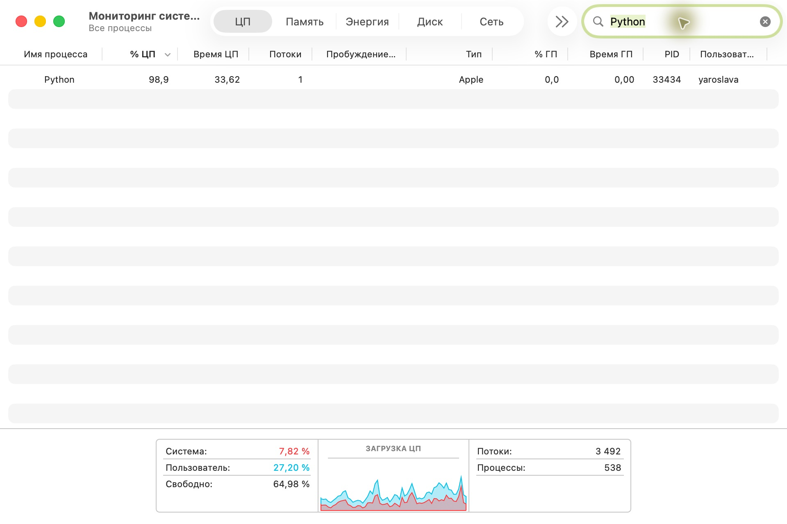
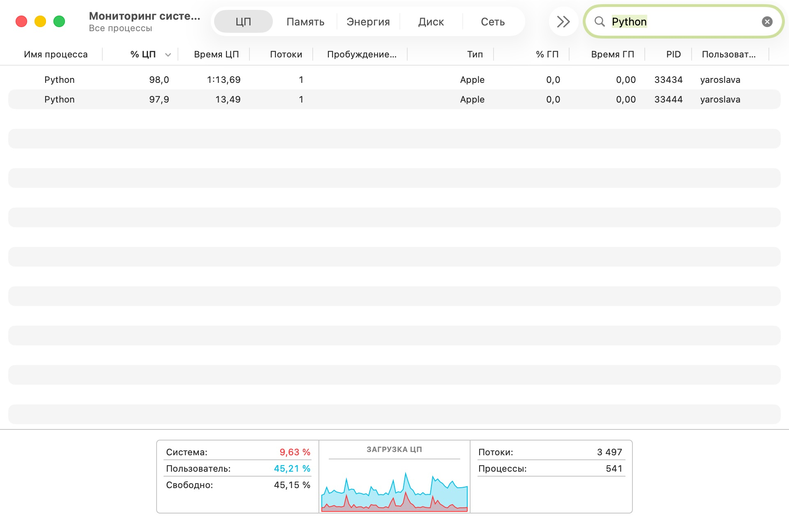
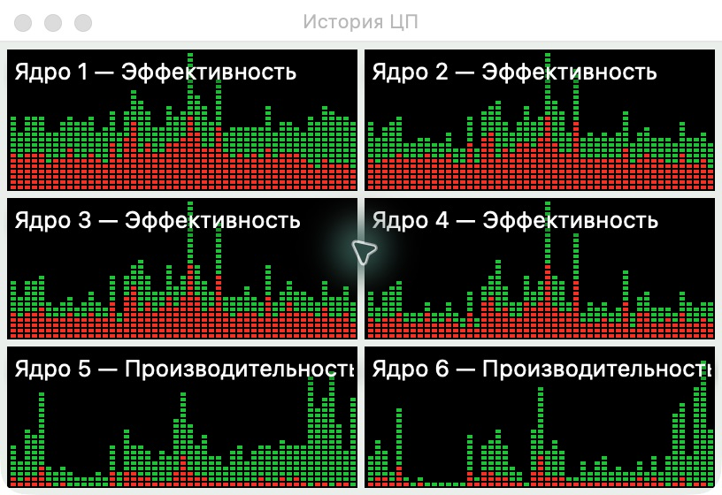
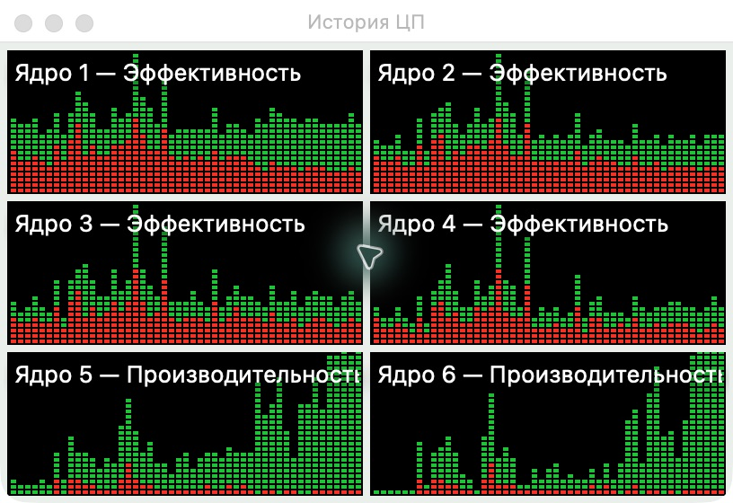
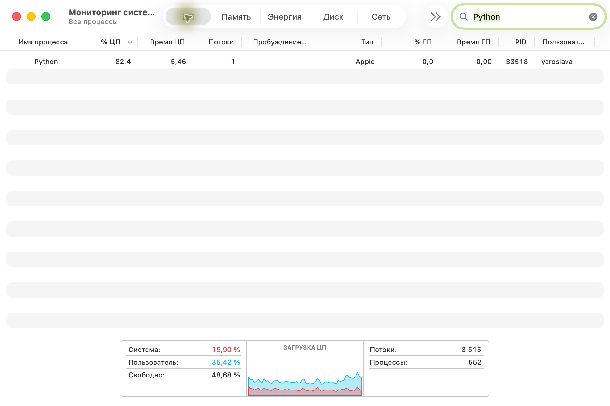
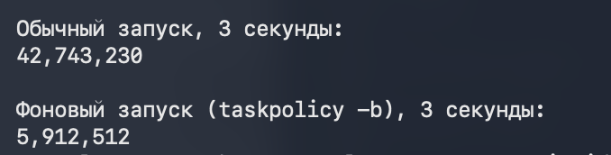
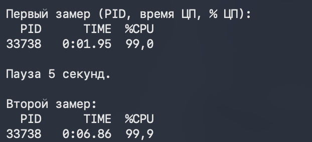

# Лабораторная работа № 6. Кто загружает процессор

macOS, 6 логических процессоров.

## 1. Одна нагрузка

Процесс Python использовал 98,9% одного ядра. Общая загрузка составила 35,02%.

## 2. Две нагрузки

Два процесса Python использовали 98,0% и 97,9% одного ядра каждый. Общая загрузка составила 54,84%. На графиках при двух нагрузках сильнее загружены ядра 5 и 6.

**Графики при одной нагрузке**

**Графики при двух нагрузках**

## 3. Фоновый режим

В отдельном замере фоновый процесс использовал 82,4% одного ядра. За три секунды обычный запуск выполнил 42 743 230 оборотов, а фоновый запуск через `taskpolicy -b` выполнил 5 912 512. Фоновый запуск выполнил примерно в 7,2 раза меньше работы.

## 4. Процессорное время

За пять секунд процессорное время выросло с 1,95 до 6,86 секунды. Средняя загрузка одного ядра за этот интервал составила 98,2%. Процент ЦП показывает долю времени, в течение которой процесс занимал ядро. Число оборотов показывает объём выполненной работы.

[Открыть отчёт в PDF](Лабораторная%20работа%206.pdf)
